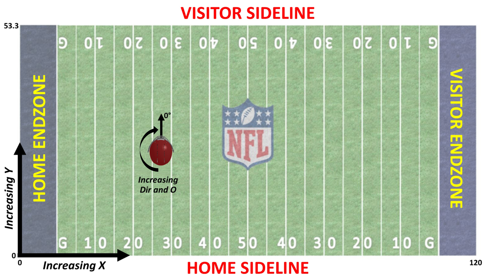

# Scouting del rival: la presión pesa más que el blitz

Dashboard de scouting para el staff de un equipo de la NFL, con un asistente de IA para el coach. Usa los datos del NFL Big Data Bowl 2023 (dropbacks de las semanas 1-8 de 2021) y el scouting de PFF.

Está pensado para el coach antes del partido: qué hace el rival, dónde es débil y qué conviene llamar.

## Hallazgo

La presión sobre el QB frena a una ofensiva mucho más que el número de rushers. La defensa que menos yardas permite, BUF, presiona sin blitzear.

| Rushers | Dropbacks | Presión | Yds por dropback | Tasa de éxito |
|---|---|---|---|---|
| 3 o menos | 436 | 22.2 % | 7.34 | 44.3 % |
| 4 | 5,990 | 34.6 % | 6.56 | 47.7 % |
| 5 | 1,678 | 46.2 % | 6.31 | 46.7 % |
| 6 o más | 417 | 51.3 % | 6.05 | 41.7 % |

- Con presión, la ofensiva promedia 3.92 yds por dropback; sin presión, 8.07 (n = 3,162 y 5,359).
- Pasar de 4 a 5 rushers sube la presión 11.6 puntos, pero las yardas solo bajan 0.25 y la tasa de éxito casi no cambia.
- Entre los 32 equipos, la correlación entre tasa de blitz y tasa de presión es de 0.18. La correlación entre presión y yardas permitidas es de −0.44.
- BUF blitzea en 16.1 % de los dropbacks (liga: 24.6 %) y presiona en 43.0 % (liga: 37.1 %). Es la defensa que menos yardas permite del dataset: 4.69 por dropback, contra 6.53 de la liga. CLE tiene un perfil parecido: 43.2 % de presión con 21.6 % de blitz. No es una regla para todas: ARI y TB, segunda y tercera en menos yardas permitidas, blitzean en 30.2 % y 39.3 %.

Contra BUF o CLE, el riesgo para la ofensiva viene de la línea de 4. La protección se planea contra sus rushers individuales, que aparecen en la pestaña "Líneas". Para una defensa, el blitz se justifica cuando la línea de 4 no gana sola.

Es una relación observada, no causal. Solo hay 8 semanas de 2021 y solo dropbacks. Además, las defensas que más blitzean pueden hacerlo justo en situaciones difíciles, como 3ª y larga.

## Pestañas

Se elige un equipo rival y la interfaz toma sus colores. Hay cinco pestañas:

- **Ataque del rival:** yardas por dropback, tasa de éxito, porcentaje de completos, sacks, presión recibida, blitz y man que enfrenta, y play action, comparados con la liga. Se desglosa por down, down y distancia, zona del campo, formación, personal, play action, cobertura rival (man, zona y cada cobertura) y número de rushers.
- **Defensa del rival:** mix de coberturas, uso de man, blitz y presión generada, en las mismas situaciones.
- **Líneas (OL / pass rush):** el eslabón débil de la línea ofensiva del rival, sus mejores pass rushers y el top 15 de la liga (mínimo 100 snaps). Por ejemplo, el eslabón débil de BUF es Cody Ford (RG), que permitió presión en 18 de 122 jugadas.
- **Pizarra de jugadas:** reproduce, con el tracking de la NFL, cualquier dropback en el que jugó el equipo, en ataque o en defensa. La ofensiva aparece como O y la defensa como X, con las rutas, el balón, la línea de golpeo, la de primer down y los jugadores que presionaron al QB.
- **Asistente IA:** chat con Amazon Nova. Responde preguntas como "¿Quién es el eslabón débil de BUF?" o "Dame un plan contra la defensa de KC en 3ª y larga".

Las pestañas de ataque y defensa incluyen hallazgos automáticos, y la de líneas señala el eslabón débil. En esas tres pestañas, cada número muestra su muestra (`n`) y un nivel de confianza. Con `n < 30` aparece "n bajo" y la barra se ve tenue.

## Cálculos

- **Datos:** `plays.csv`, `pffScoutingData.csv` y `players.csv`, con 8,522 dropbacks de 122 juegos. Se excluyen los intentos de 2 puntos (`down == 0`). La pizarra usa además `games.csv` y el tracking (`tracking/`).
- **Yardas:** `prePenaltyPlayResult`, para no mezclar yardas de castigo.
- **Éxito:** ganar el 40 % de la distancia en 1ª, el 60 % en 2ª y el 100 % en 3ª y 4ª.
- **Presión:** hit, hurry o sack de PFF en cualquier pass rusher de la jugada.
- **Blitz:** 5 o más jugadores con el rol `Pass Rush`.
- **Confianza:** baja con n < 30, media de 30 a 99 y alta con 100 o más.
- **Rankings de jugadores:** la tasa de presión se suaviza sumando 50 jugadas con la tasa de la liga, para que un jugador con pocas jugadas no encabece la lista por azar.
- **Pizarra:** el tracking mide el campo en yardas, de 0 a 120 a lo largo y de 0 a 53.3 a lo ancho (ver la figura). El campo se voltea cuando la ofensiva va a la izquierda, así que siempre avanza hacia la derecha. La animación va a 10 frames por segundo, como el tracking.
- **Asistente:** agente de Strands con tres herramientas que llaman a las mismas funciones de pandas que el dashboard. El modelo elige la herramienta, interpreta el resultado y redacta, sin calcular números propios. Bajo cada respuesta se muestra qué herramientas consultó. Si Bedrock no está disponible, el resto de la app sigue funcionando.



## Estructura

```
backend/
  main.py        FastAPI: /health, /api/equipos, /api/equipo/{equipo}/{ofensiva|defensa},
                 /api/lineas/{equipo}, /api/lineas/lideres, /api/jugadas/{equipo},
                 /api/jugada/{gameId}/{playId}, POST /api/asistente
  datos.py       Carga y limpieza de datos, métricas por jugada
  reportes.py    Reporte de scouting ofensivo y defensivo, hallazgos automáticos
  lineas.py      Protección (OL) y pass rush, con tasas suavizadas
  pizarra.py     Lista de jugadas y tracking frame a frame para la pizarra
  asistente.py   Agente de Strands con Amazon Nova y sus herramientas
dashboard/src/
  App.tsx        Selector de equipo y pestañas
  teamColors.ts  Colores de los 32 equipos
  tema.tsx       Tema de la interfaz según el equipo elegido
  views/         ReporteEquipo, Lineas, Pizarra, Asistente
```


- Carlos Fabián Esteva Gallegos.
- Ibrahim Munive Ramírez.
